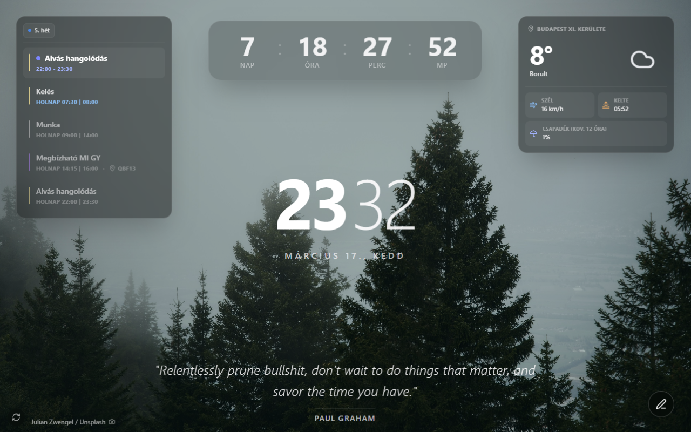

<h1> Hub Extension</h1>

A Chrome extension that replaces the new tab page with a minimalist dashboard. Shows time, weather, upcoming Google Calendar events, a daily quote, a countdown timer, a focus timer, a quick note, and notes from your own Memos server — all over a full-screen Unsplash background.

## Features

- **Clock** — current time and date with a time-of-day greeting
- **Weather** — temperature, wind, rain probability, sunrise/sunset, and a four-day forecast via [Open-Meteo](https://open-meteo.com/)
- **Calendar** — next upcoming Google Calendar events (read-only OAuth)
- **Quote** — a daily quote from the source you pick in settings (the list comes from the Hub API's `GET /api/quote/sources`, so only sources that deployment can serve appear), or your own list, which never touches the network. Quotes are cached by the Hub API, with a bundled Stoic fallback offline; a refresh button on the quote fetches another one
- **Countdown** — custom target date configurable from settings
- **Focus timer** — Pomodoro-style work/break timer owned by the service worker, so it keeps running with no tab open and raises exactly one notification per phase change
- **Quick note** — a scratchpad stored locally; clearing it can be undone for a few seconds
- **Memos** — your notes from a self-hosted [Memos](https://usememos.com) instance (v0.30+), connected with an access token and a host permission granted for that one server at runtime. The token is kept in `chrome.storage.local`, never synced and never part of a settings backup
- **Background** — a random Unsplash photo fetched from the Hub API and cached daily, or a custom image of your own; dimmable, with tomorrow's photo prefetched ahead of time

Press `.` anywhere to toggle the UI overlay on/off, or double-click. Escape always brings it back. A settings button on the page opens the settings in a tab, for when the toolbar icon is not pinned. A first install shows a short welcome card; later updates show what changed.

## Preview



## Local development

### 1. Install dependencies

From the monorepo root:

```bash
pnpm install
```

### 2. Configure environment variables

Create `apps/extension/.env`:

```
VITE_DEV_CLIENT_ID=your_google_oauth_client_id
```

- **Google OAuth client ID**: [console.cloud.google.com](https://console.cloud.google.com) → create an OAuth 2.0 Client ID for a Chrome Extension

### 3. Start the dev server

```bash
cd apps/extension
pnpm dev
# Dev server at http://localhost:5173
```

> **Note:** The Vite dev server is useful for iterating on UI. To test as an actual new tab override, load the built extension in Chrome (see below).

### 4. Load in Chrome as an unpacked extension

```bash
pnpm build          # Outputs to dist/
```

1. Open `chrome://extensions`
2. Enable **Developer mode** (top right)
3. Click **Load unpacked**
4. Select the `apps/extension/dist/` folder
5. Open a new tab

After code changes, run `pnpm build` again and click the refresh icon on the extension card in `chrome://extensions`.

## Scripts

| Command            | Description                                      |
| ------------------ | ------------------------------------------------ |
| `pnpm dev`         | Start Vite dev server at `http://localhost:5173` |
| `pnpm build`       | Type-check + production build → `dist/`          |
| `pnpm run pack`    | Build and zip `dist/` → `extension-release.zip`  |
| `pnpm typecheck`   | Type-check only                                  |
| `pnpm lint`        | Run ESLint                                       |
| `pnpm test`        | Run Vitest once                                  |
| `pnpm test:watch`  | Run Vitest in watch mode                         |
| `pnpm check`       | Type-check + lint + test                         |

## Tests

Vitest with happy-dom. `src/test/` provides stubs for the `chrome` APIs and the
Cache API; `setup.ts` reinstalls them and calls `vi.resetModules()` before every
test, so hooks that read module-level state (`useSettings`) must be imported
inside the test with `await import(...)` rather than at the top of the file.

Covered: the settings store; background fetching, caching and prefetch; the
image cache, including the custom-image path; daily cache expiry; calendar
event categorisation; four-day forecast summarisation and precipitation
aggregation; changelog parsing; the "what's new" notice; widget visibility;
background dimming; the quote fallback; the document-title hook; the settings
schema and backup import; the Memos client, hook, widget and settings section;
the popup form and its save-as-you-go behaviour; the error boundaries and
recovery screen; and the service worker itself — alarm scheduling, install-time
cache cleanup, and the Pomodoro timer's start/reset/advance/rehydrate state
machine under concurrent and cross-restart scenarios, including
notification-locale parity across every shipped locale. How it looks, and real
Chrome integration, are still verified by hand in Chrome.

## Deployment

The extension deploys to the Chrome Web Store via GitHub Actions on every `extension@*` tag push.

### Automated deployment (GitHub Actions)

1. Add these secrets to your GitHub repository:
   - `EXTENSION_ID` — Chrome Web Store extension ID (from the store URL)
   - `CLIENT_ID` — Google OAuth client ID (for Web Store API)
   - `CLIENT_SECRET` — Google OAuth client secret
   - `REFRESH_TOKEN` — Google OAuth refresh token

2. Push a version tag:
   ```bash
   git tag extension@2.0.1
   git push origin extension@2.0.1
   ```

Normally you do not push the tag yourself: a push to `main` runs the Check workflow, and when it passes `release.yml` cuts the tags.

GitHub Actions runs `.github/workflows/deploy.yml`, which runs `pnpm run check`, builds with `pnpm nx run extension:pack` (produces `extension-release.zip`) and uploads to the Chrome Web Store. The upload is a draft: it is submitted for review automatically only when the repository variable `PUBLISH_EXTENSION` is `true`. The workflow also reads the `CWS_PUBLISHER_ID` repository variable (the Web Store API v2 addresses items under their publisher).

### Manual submission

```bash
pnpm run pack
# Creates extension-release.zip from dist/
```

Use `pnpm run pack` (or `pnpm nx run extension:pack` from the root), not
`pnpm pack`: that one is pnpm's own command and builds an npm tarball instead.

Upload `extension-release.zip` manually at [chrome.google.com/webstore/devconsole](https://chrome.google.com/webstore/devconsole).

## Settings

Click the extension icon, or the settings button on the new tab page, to open
the settings. They are split into tabs (General, Appearance, Weather,
Countdown, Focus, Calendars, Widgets, Memos) and there is no Apply button:
each change is saved as you make it, and a status line under the tabs says
whether it went through.

| Setting              | Description                                                 |
| -------------------- | ------------------------------------------------------------ |
| Language             | UI language, or auto-detect from the browser                |
| Quote source         | Where the daily quote comes from, an optional category for sources that take one, or your own list of quotes |
| Background source    | Unsplash photos, or a custom uploaded image                 |
| Background tags      | Comma-separated Unsplash search tags (Unsplash source only) |
| Background dimming   | Darkens the photo behind the UI, 0-70%                       |
| Location             | City name or auto-detect via GPS or IP                      |
| Countdown target     | Date to count down to                                        |
| Focus / break length | Minutes for each Pomodoro work phase and each break          |
| Calendars            | Select which Google Calendars to display                    |
| Visible widgets      | Show or hide each widget independently                      |
| Memos                | Server URL, access token (connect), and an optional tag to open on |
| Backup               | Export the settings to a JSON file, or import one           |

Settings sync across devices via Chrome Storage Sync. The exceptions are the
Memos access token and the uploaded background image, which stay on the device.

## Permissions

| Permission      | Reason                                                                                                  |
| --------------- | --------------------------------------------------------------------------------------------------------- |
| `storage`       | Persist settings via Chrome Storage Sync, plus local caches and Pomodoro state via `chrome.storage.local` |
| `geolocation`   | Auto-detect location for weather                                                                         |
| `identity`      | Google Calendar OAuth login                                                                              |
| `alarms`        | Schedule the daily background prefetch and the Pomodoro phase timer, both owned by the service worker    |
| `notifications` | Show the one system notification when a focus or break phase ends                                       |

OAuth scope: `https://www.googleapis.com/auth/calendar.readonly` — read-only, and
covers both the calendar list (for the picker and calendar colours) and events.

Every host the extension calls must also appear in `host_permissions` in
[manifest.json](manifest.json), except the Memos server, which is requested at
runtime (`optional_host_permissions`) for the one origin the user connects. Any change to permissions, scopes or hosts
must be mirrored in [privacy-policy.md](./privacy-policy.md).

## Stack

| Tool                                       | Purpose                      |
| ------------------------------------------ | ---------------------------- |
| [React 19](https://react.dev/)             | UI framework                 |
| [Vite 7](https://vitejs.dev/)              | Build tool and dev server    |
| [CRXJS](https://crxjs.dev/vite-plugin)     | Chrome extension Vite plugin |
| [Tailwind CSS 4](https://tailwindcss.com/) | Styling                      |
| [Lucide React](https://lucide.dev/)        | Icons                        |
| [date-fns](https://date-fns.org/)          | Date formatting              |
| [Fontsource](https://fontsource.org/)      | Self-hosted Inter font       |
| [Vitest](https://vitest.dev/)              | Tests (happy-dom)            |
| TypeScript                                 | Language                     |

## External APIs

| API                                             | Used for                        | Auth             |
| ----------------------------------------------- | ------------------------------- | ---------------- |
| [Open-Meteo](https://open-meteo.com/)           | Weather data, city lookup       | None (free)      |
| [BigDataCloud](https://www.bigdatacloud.com/)   | Reverse geocoding               | None (free tier) |
| [GeoJS](https://www.geojs.io/)                  | IP location fallback            | None (free)      |
| Hub API (`apps/api`)                            | Background images, daily quotes | None             |
| Google Calendar API                             | Calendar events                 | OAuth 2.0        |
| Your own Memos server                           | The Memos widget                | Access token     |

## Privacy policy

See [privacy-policy.md](./privacy-policy.md).

